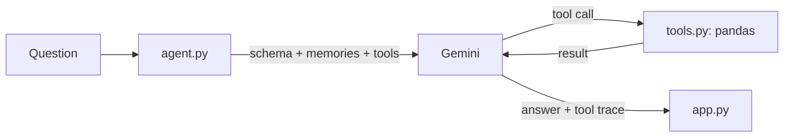

# CSV Analysis Agent

Ask questions about any CSV in plain English. A Gemini agent picks from 9 pandas tools, runs them on the real data, and answers only with the numbers they return. Every tool call is shown under the answer, and the agent remembers facts across sessions.

BYTE MAIT Applied ML recruitment, **Task 1: The Agentic Task**.

**Live app:** https://csv-analysis-agent-azjyqjb9faklyje57jakdr.streamlit.app/ · **Demo video:** [demo/demo.mp4](demo/demo.mp4)

## Stack

Python · pandas · Streamlit · Google Gemini API (`google-genai` SDK, function calling). Default model `gemini-3.5-flash-lite`; `gemini-3.8-flash`, `gemini-3.6-flash` and `gemini-3.5-flash` are backups if it is busy or out of quota. Memory is a local JSON file.

## How it works



Gemini only sees the column names, a few example values and tool results, never the whole dataset, so every number comes from a real calculation. Tool errors go back to Gemini so it can fix the call.

## Tools

| Tool | What it does |
|---|---|
| `dataset_overview` | Rows, column types, missing values, examples |
| `filter_rows` | Rows matching a condition (numbers, text, dates); the result can be saved as a named subset |
| `column_statistics` | Count, sum, mean, median, std, min, quartiles, max |
| `group_and_aggregate` | mean / sum / count / min / max / median per group |
| `correlations` | Correlation between numeric columns, strongest first |
| `top_rows` | Top or bottom n rows by a column |
| `value_counts` | How often each value appears |
| `find_outliers` | Unusual values (1.5 × IQR rule) |
| `add_calculated_column` | New column from two columns, or a column and a number |
| `save_memory` / `forget_memory` | Save or delete a fact for future sessions |

Tools chain through named subsets. For "average attendance of Maths students who scored above 70": `filter_rows(Subject = Maths)` → `filter_rows(Marks > 70)` → `column_statistics(Attendance)` = 86.

## Memory (bonus)

- **Stores** only small named facts: definitions (`revenue = Units × Unit_Price`), corrections, reusable filters (`good_attendance: Attendance >= 90`) and preferences. Never chats or data.
- **Scope:** a memory applies to datasets with the same columns, or to every dataset (global). Relevant memories are added to the agent's instructions each session.
- **Conflicts:** saving under an existing name replaces the fact and keeps the old version in history. A dataset memory beats a global one with the same name.
- **Stale facts:** memories older than 30 days are flagged, and the agent re-checks them with tools.
- **Control:** the sidebar shows, adds, deletes and clears memories, or you can tell the agent "forget …".

Example: *"Remember that revenue means Units multiplied by Unit_Price."* → restart → *"Which region had the highest revenue?"* → the agent builds the Revenue column itself and answers **South, 426,274.50**.

## Setup

```bash
git clone https://github.com/pulkitsobti/csv-analysis-agent.git
cd csv-analysis-agent
python -m venv .venv
.venv\Scripts\activate        # macOS/Linux: source .venv/bin/activate
pip install -r requirements.txt
```

Add a `.env` file with a free key from https://aistudio.google.com/apikey:

```
GEMINI_API_KEY=your_key_here
```

Run `streamlit run app.py`, then pick a sample dataset or upload a CSV.

## Limitations and security

- Only the fixed tools can run, with no `eval`/`exec` on model output. Safer, but some questions (pivots, time series) aren't possible yet.
- The free Gemini tier allows about 20 requests per day per model; the app falls back to the next model when one runs out.
- Memory is one local file, shared by everyone using a deployed app and reset when Streamlit Cloud restarts.
- The API key lives in `.env` or Streamlit secrets, never in the repo. Results sent to Gemini are capped at 20 rows.

## Files

```
app.py      Streamlit UI: chat, tool trace, memory sidebar, manual tool panel
agent.py    Gemini tool loop, prompt, model fallback
tools.py    pandas analysis functions
memory.py   memory storage, scope, conflicts, staleness
```

Built with help from Claude Code (AI coding assistant).
