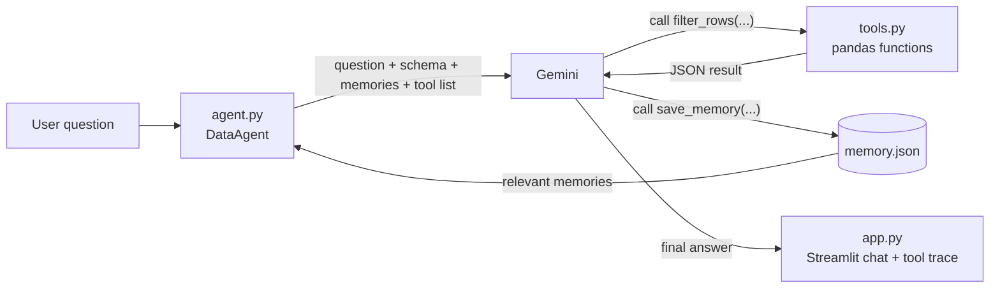

# CSV Analysis Agent

A data-analysis agent for any CSV file. You ask a question in plain English, and the agent decides which analysis tools to run, runs them on the real data with pandas, and answers using only the numbers those tools return. Every tool call and its result are shown under the answer.

It also has **persistent memory**: it remembers definitions, corrections and named filters across sessions, and uses them in later answers.

> Submission for the BYTE MAIT Applied ML recruitment, **Task 1: The Agentic Task**.

**Live app:** https://csv-analysis-agent-azjyqjb9faklyje57jakdr.streamlit.app/ · **Demo video:** _add link_

---

## Stack

| Part | What is used |
|---|---|
| Language model | Google Gemini via the `google-genai` Python SDK: `gemini-3.8-flash`, `gemini-3.6-flash`, `gemini-3.5-flash`, `gemini-3.5-flash-lite`. The model picked in the sidebar is tried first; the others are backups if it is busy or out of quota |
| Tool calling | Gemini function calling, with the SDK's automatic function-calling loop |
| Data analysis | pandas |
| Web app | Streamlit |
| Memory storage | A local JSON file (`memory.json`) |
| Config | python-dotenv (`.env`) |

No other APIs or models are used.

## How it works



1. `app.py` loads the CSV and sends the question to `DataAgent.ask()`.
2. The agent gives Gemini the column names, types and a few example values (not the whole dataset), any saved memories that apply to this dataset, and the list of tools.
3. Gemini replies with tool calls. The SDK runs the matching Python function and sends the result back. This repeats (up to 12 rounds) until Gemini writes a final answer.
4. The app shows the answer, then every tool call with its arguments and result.

Because Gemini only sees tool results, it cannot "know" a number without calculating it. If a tool fails (for example a wrong column name), the error message goes back to Gemini so it can fix the call.

## Tools

| # | Tool | What it does | Example question |
|---|---|---|---|
| 1 | `dataset_overview` | Rows, column types, missing values, example values | "What's in this file?" |
| 2 | `filter_rows` | Keep rows matching a condition (`equals`, `not_equals`, `contains`, `>`, `<`, `>=`, `<=`; works on numbers, text and dates). The result can be **saved as a named subset** | "Orders from the North after March" |
| 3 | `column_statistics` | Count, sum, mean, median, std, min, quartiles, max | "Average units per order?" |
| 4 | `group_and_aggregate` | mean/sum/count/min/max/median per group | "Which region sells the most?" |
| 5 | `correlations` | Correlation between all numeric column pairs, strongest first | "Is attendance related to marks?" |
| 6 | `top_rows` | Top/bottom n rows by a numeric column (keeps ties) | "Who are the top 3 students?" |
| 7 | `value_counts` | Frequency and percentage of each value | "Most common product?" |
| 8 | `find_outliers` | Unusual values using the 1.5 × IQR rule | "Any strange orders?" |
| 9 | `add_calculated_column` | New column from two columns or a column and a number | "Revenue = Units × Unit_Price" |
| 10 | `save_memory` | Save a fact for future sessions | "Remember that…" |
| 11 | `forget_memory` | Delete a saved fact | "Forget the revenue definition" |

**Chaining tools with named subsets.** Most tools take a `subset` argument. For "average attendance of Maths students who scored above 70", the agent runs:

```
filter_rows(column="Subject", operator="equals", value="Maths", save_as="maths")
filter_rows(column="Marks", operator=">", value="70", source="maths", save_as="maths_70")
column_statistics(column="Attendance", subset="maths_70")   ->  mean = 86
```

## Memory design (bonus)

**What is stored.** Only small named facts, each with a `kind`:

| kind | example |
|---|---|
| `definition` | `revenue = Units multiply Unit_Price` |
| `correction` | `Marks are out of 120, not 100` |
| `filter` | `good_attendance: Attendance >= 90` |
| `preference` | `Show results as a table` |

Chat logs, rows and datasets are never stored.

**When it is saved.** The agent calls `save_memory` when the user asks it to remember something, defines a term, corrects it, or names a filter to reuse. The user can also add memories by hand in the sidebar.

**Retrieval (when it is relevant).** Each memory has a scope:
- `dataset`: applies only to datasets with the same set of column names (stored as a hash of the sorted column names). Memories about the sales file never show up for the students file.
- `global`: applies to every dataset.

At the start of each question, the relevant memories are put into the agent's instructions, and it is told to use them and say which one it used.

**Conflicts.** Saving under an existing name replaces the old fact, and the old version is kept in that memory's `history`. The tool result tells the agent what the previous value was, so it can tell the user what changed. If a dataset memory and a global memory have the same name, the dataset one wins because it is more specific.

**Stale facts.** Memories not updated for 30 days are marked "POSSIBLY STALE" in the agent's instructions, and the agent is told to check them against the data before relying on them. The sidebar shows a ⚠️ on them.

**User control.** The sidebar lists every memory that applies to the current dataset (name, kind, scope, last update, older versions), with buttons to delete one, add one, or clear everything. The user can also just tell the agent "forget …".

**Example (tested):**
1. Session 1, sales data: *"Remember that revenue means Units multiplied by Unit_Price."* → `save_memory(name="revenue_definition", kind="definition", content="revenue = Units multiply Unit_Price")`
2. App restarted. Session 2: *"Which region had the highest revenue?"* → `add_calculated_column(Revenue = Units multiply Unit_Price)` → `group_and_aggregate(Region, Revenue, sum)` → **South, 426,274.50**

## Setup

Requires Python 3.10+.

```bash
git clone https://github.com/pulkitsobti/csv-analysis-agent.git
cd csv-analysis-agent
python -m venv .venv
.venv\Scripts\activate          # Windows  (macOS/Linux: source .venv/bin/activate)
pip install -r requirements.txt
```

Create a `.env` file with a free Gemini API key from https://aistudio.google.com/apikey:

```
GEMINI_API_KEY=your_key_here
```

Run:

```bash
streamlit run app.py
```

Pick a sample dataset (`sample_data/`) or upload your own CSV. Optional: set `GEMINI_MODELS` in `.env` to a comma-separated list of models to try in order.

## Trade-offs and limitations

- **Fixed tools instead of generated code.** The agent can only call the functions above; it cannot write and run pandas code. This is safer and every step is easy to check, but some questions (pivot tables, time-series resampling) need more than one tool or are not possible yet.
- **Free-tier limits.** The free Gemini tier allows about 20 requests per day per model, and each tool round is one request. The agent asks for independent tools in parallel, puts the schema in the prompt to skip extra calls, and falls back to the next model when one is rate-limited.
- **Memory scope is exact.** Renaming or adding a column makes it a "different dataset" for dataset-scoped memories. Global memories still apply.
- **Memory is a local file.** On Streamlit Community Cloud the file is reset when the app restarts, and all users of a deployed app share one memory file.
- **Large files.** Tool results are capped at 20 rows, so very large CSVs work, but the whole file is loaded into memory.

## Security

- The API key is read from `.env` (git-ignored) or Streamlit secrets and is never shown. The optional key box in the sidebar is a password field and is not saved.
- The model never runs code: no `eval`, `exec` or `DataFrame.query` on model output. Only fixed, validated tool functions are called.
- Only the schema, a few example values and tool results (max 20 rows) are sent to Gemini, not the whole dataset.

## Project structure

```
app.py          Streamlit UI: data loading, chat, tool trace, memory sidebar
agent.py        DataAgent: prompt, tool definitions, Gemini tool loop, model fallback
tools.py        The pandas analysis functions
memory.py       MemoryStore: saving, scoping, conflicts, staleness
sample_data/    students.csv (6 rows) and sales.csv (150 rows, synthetic, with missing values and outliers)
```

## My notes

<!-- Write this section yourself: what you learned, what was hard, what you'd add next. -->

Built with help from Claude Code (AI coding assistant); commits that it helped write carry a `Co-Authored-By` line.
